# Modelo de datos del Sistema de Expedientes Clínicos

Centro de Salud San José La Comunidad, zona 10 de Mixco (SJLC). **Versión 1.0.**

Este documento describe la base de datos tal como queda después de aplicar las 25 migraciones de `db/migraciones/` (`001_extensiones_y_roles_bd.sql` a `025_usuarios_eliminados.sql`). Es la referencia técnica del modelo: diagrama entidad-relación, diccionario de datos, correlativos, reglas que aplica la propia base, roles y permisos.

- Motor: PostgreSQL 16 (`postgres:16-alpine`), esquema `public`.
- Zona horaria de la base: `America/Guatemala` (fijada con `ALTER DATABASE ... SET timezone` en la migración 001). Todas las horas son `timestamptz`.
- 31 tablas: 30 del sistema y `migraciones_aplicadas`, que usa el migrador para llevar el control de versiones.
- Las migraciones se aplican con `docker compose run --rm backend npm run migrar`. Cada archivo se aplica una sola vez, dentro de una transacción, y se guarda su suma SHA-256. Si un archivo ya aplicado cambia, el migrador se detiene: los cambios siempre van en una migración nueva.

---

## 1. Diagrama entidad-relación

Se muestran todas las tablas con sus claves primarias (PK), foráneas (FK) y únicas (UK). Las demás columnas están en el diccionario (sección 3). Notación de Mermaid: `||` exactamente uno, `|o` cero o uno, `o{` cero o muchos.

```mermaid
erDiagram
    %% Catálogos
    areas {
        smallint id_area PK
        text nombre_area UK
    }
    roles {
        smallint id_rol PK
        text nombre_rol UK
        smallint id_area FK "nulo para administrador"
    }
    tipos_atencion {
        smallint id_tipo_atencion PK
        text nombre_tipo_atencion UK
        boolean es_emergencia
    }
    pueblos {
        smallint id_pueblo PK
        text nombre_pueblo UK
    }
    comunidades_linguisticas {
        smallint id_comunidad_linguistica PK
        text nombre_comunidad_linguistica UK
    }
    departamentos {
        smallint id_departamento PK
        text nombre_departamento UK
    }
    municipios {
        smallint id_municipio PK
        smallint id_departamento FK
        text nombre_municipio
    }
    colonias_sectores {
        smallint id_colonia_sector PK
        smallint id_municipio FK
        smallint zona
        text nombre_colonia_sector
    }
    presentaciones {
        smallint id_presentacion PK
        text nombre_presentacion UK
    }
    medicamentos {
        int id_medicamento PK
        text nombre_medicamento
        smallint id_presentacion FK
    }
    vacunas {
        smallint id_vacuna PK
        text nombre_vacuna UK
    }

    %% Seguridad y auditoría
    usuarios {
        int id_usuario PK
        text nombre_usuario UK
        smallint id_rol FK
    }
    sesiones {
        uuid id_sesion PK
        int id_usuario FK
    }
    bitacora {
        bigint id_bitacora PK
        int id_usuario FK "nulo si no hay usuario"
        text accion
        text entidad
    }
    migraciones_aplicadas {
        text nombre_archivo PK
        text checksum_sha256
    }

    %% Pacientes
    pacientes {
        int id_paciente PK
        text codigo_paciente UK "SJLC-000123"
        char cui "UK parcial"
        smallint id_municipio_residencia FK
        smallint id_municipio_nacimiento FK
        smallint id_pueblo FK
        smallint id_comunidad_linguistica FK
        smallint id_colonia_sector FK
        int id_paciente_principal FK "si fue unido"
        int id_usuario FK
    }
    encargados {
        int id_encargado PK
        char dpi
    }
    pacientes_encargados {
        int id_paciente PK, FK
        int id_encargado PK, FK
        text parentesco
    }
    uniones_pacientes {
        int id_union_paciente PK
        int id_paciente FK "registro conservado"
        int id_paciente_unido FK, UK "registro absorbido"
        int id_usuario FK
    }

    %% Atención
    atenciones {
        int id_atencion PK
        text numero_atencion UK "A-004587"
        int id_paciente FK
        smallint id_tipo_atencion FK
        int id_usuario FK
    }
    recorridos_atencion {
        int id_recorrido_atencion PK
        int id_atencion FK
        smallint id_area FK
        int id_usuario FK "quien atiende"
    }
    proximos_controles {
        int id_proximo_control PK
        int id_paciente FK
        int id_atencion FK
        smallint id_area FK
        int id_usuario FK
    }

    %% Registros clínicos
    signos_vitales {
        int id_signo_vital PK
        int id_atencion FK
        int id_usuario FK
        int corrige_a FK, UK
    }
    consultas {
        int id_consulta PK
        int id_atencion FK
        int id_usuario FK
        int corrige_a FK, UK
    }
    diagnosticos_consulta {
        int id_diagnostico_consulta PK
        int id_consulta FK
    }
    recetas {
        int id_receta PK
        int id_atencion FK
        smallint id_area FK
        int id_usuario FK
        int corrige_a FK, UK
    }
    recetas_detalle {
        int id_receta_detalle PK
        int id_receta FK
        int id_medicamento FK "opcional"
        text medicamento_texto
    }
    evaluaciones_nutricionales {
        int id_evaluacion_nutricional PK
        int id_atencion FK
        int id_usuario FK
        int corrige_a FK, UK
    }
    vacunas_aplicadas {
        int id_vacuna_aplicada PK
        int id_atencion FK
        smallint id_vacuna FK "opcional"
        text nombre_vacuna_texto
        int id_usuario FK
        int corrige_a FK, UK
    }

    %% Farmacia
    entregas_farmacia {
        int id_entrega_farmacia PK
        int id_receta FK, UK
        int numero_orden UK
        int id_usuario FK
    }
    entregas_farmacia_detalle {
        int id_entrega_farmacia_detalle PK
        int id_entrega_farmacia FK
        int id_receta_detalle FK, UK
    }

    %% Relaciones: catálogos
    areas |o--o{ roles : "área del rol"
    departamentos ||--o{ municipios : "contiene"
    municipios ||--o{ colonias_sectores : "contiene"
    presentaciones ||--o{ medicamentos : "presentación"

    %% Relaciones: seguridad
    roles ||--o{ usuarios : "rol"
    usuarios ||--o{ sesiones : "abre"
    usuarios |o--o{ bitacora : "actor"

    %% Relaciones: pacientes
    municipios |o--o{ pacientes : "residencia"
    municipios |o--o{ pacientes : "nacimiento"
    pueblos |o--o{ pacientes : "pueblo"
    comunidades_linguisticas ||--o{ pacientes : "comunidad lingüística"
    colonias_sectores |o--o{ pacientes : "colonia o sector"
    pacientes |o--o{ pacientes : "unido a (principal)"
    usuarios ||--o{ pacientes : "registró"
    pacientes ||--o{ pacientes_encargados : "tiene"
    encargados ||--o{ pacientes_encargados : "es encargado"
    pacientes ||--o{ uniones_pacientes : "conserva"
    pacientes ||--o| uniones_pacientes : "absorbido"
    usuarios ||--o{ uniones_pacientes : "unió"

    %% Relaciones: atención
    pacientes ||--o{ atenciones : "llega"
    tipos_atencion ||--o{ atenciones : "tipo"
    usuarios ||--o{ atenciones : "abrió"
    atenciones ||--o{ recorridos_atencion : "recorre"
    areas ||--o{ recorridos_atencion : "área"
    usuarios |o--o{ recorridos_atencion : "atiende"
    pacientes ||--o{ proximos_controles : "pendiente"
    atenciones ||--o{ proximos_controles : "se dejó en"
    areas ||--o{ proximos_controles : "área destino"
    usuarios ||--o{ proximos_controles : "dejó"

    %% Relaciones: registros clínicos
    atenciones ||--o{ signos_vitales : "signos"
    usuarios ||--o{ signos_vitales : "registró"
    signos_vitales |o--o| signos_vitales : "corrige_a"
    atenciones ||--o{ consultas : "consulta"
    usuarios ||--o{ consultas : "doctor"
    consultas |o--o| consultas : "corrige_a"
    consultas ||--o{ diagnosticos_consulta : "diagnósticos"
    atenciones ||--o{ recetas : "receta"
    areas ||--o{ recetas : "área que receta"
    usuarios ||--o{ recetas : "recetó"
    recetas |o--o| recetas : "corrige_a"
    recetas ||--o{ recetas_detalle : "renglones"
    medicamentos |o--o{ recetas_detalle : "catálogo (opcional)"
    atenciones ||--o{ evaluaciones_nutricionales : "evaluación"
    usuarios ||--o{ evaluaciones_nutricionales : "evaluó"
    evaluaciones_nutricionales |o--o| evaluaciones_nutricionales : "corrige_a"
    atenciones ||--o{ vacunas_aplicadas : "vacunas"
    vacunas |o--o{ vacunas_aplicadas : "catálogo (opcional)"
    usuarios ||--o{ vacunas_aplicadas : "aplicó"
    vacunas_aplicadas |o--o| vacunas_aplicadas : "corrige_a"

    %% Relaciones: farmacia
    recetas ||--o| entregas_farmacia : "se entrega en"
    usuarios ||--o{ entregas_farmacia : "entregó"
    entregas_farmacia ||--o{ entregas_farmacia_detalle : "renglones"
    recetas_detalle ||--o| entregas_farmacia_detalle : "se entrega en"
```



`migraciones_aplicadas` no tiene relaciones: es de control interno.

Lo que **no** se guarda en tablas:

- **Edad, IMC y tiempos de espera.** Se calculan en un solo servicio del backend (`backend/src/servicios/calculos.ts`) a partir de `fecha_nacimiento`, peso, talla y las horas de `recorridos_atencion`.
- **Ruta sugerida por tipo de atención** (a qué áreas se puede enviar desde cada una). Es una regla del backend, porque las rutas son sugeridas y no rígidas.
- **Datos del centro** para encabezados de ticket y reportes. Están en la configuración del backend.

---

## 2. Convenciones de nombres

- Tablas en plural, en español, `snake_case`, sin tildes ni ñ (`contrasena`, `anios`, `linguisticas`).
- Clave primaria `id_<entidad_singular>` (`id_paciente`, `id_recorrido_atencion`). Las tablas de detalle o de relación siguen la misma regla (`id_receta_detalle`, `id_entrega_farmacia_detalle`). `pacientes_encargados` usa clave compuesta `(id_paciente, id_encargado)`.
- Las claves foráneas se llaman igual que la clave primaria que referencian (`id_atencion`, `id_usuario`). Cuando una tabla tiene dos FK a la misma tabla, el nombre lleva un sufijo que explica el papel: `id_municipio_residencia`, `id_municipio_nacimiento`, `id_paciente_principal`, `id_paciente_unido`. Las autorreferencias de versionado se llaman `corrige_a`.
- Columnas descriptivas, nunca genéricas: `codigo_paciente`, `fecha_hora_llegada`, `nombre_tipo_atencion`.
- Tipos de las claves:
  - `integer GENERATED ALWAYS AS IDENTITY` en tablas de datos: la aplicación no puede fijar el id.
  - `smallint GENERATED BY DEFAULT AS IDENTITY` en catálogos que el seed carga con ids fijos (`areas`, `roles`, `tipos_atencion`, `presentaciones`, `vacunas`); `medicamentos` usa `integer`. `colonias_sectores` usa `smallint GENERATED ALWAYS`.
  - `smallint` sin identidad, con el **código oficial** como id, en `pueblos`, `comunidades_linguisticas`, `departamentos` y `municipios`.
  - `bigint` en `bitacora` (la tabla que más crece) y `uuid` en `sesiones`.
- Horas: `fecha_hora_*` (`timestamptz`); fechas sin hora: `fecha_*` (`date`). Casi todas las tablas llevan `fecha_creacion timestamptz NOT NULL DEFAULT now()`. Las excepciones son `bitacora`, `uniones_pacientes` y `entregas_farmacia`, que guardan el momento del hecho en `fecha_hora`; `entregas_farmacia_detalle`, que usa la hora de su entrega; y `migraciones_aplicadas` (`fecha_aplicacion`).
- Estados y valores cerrados: `text` con `CHECK ... IN (...)`, en minúsculas y sin tildes (`en_espera`, `se_retiro`).
- Columnas de **versionado** en registros clínicos (`signos_vitales`, `consultas`, `recetas`, `evaluaciones_nutricionales`, `vacunas_aplicadas`): `vigente boolean NOT NULL DEFAULT true`, `corrige_a` (FK única a la misma tabla) e `id_usuario` de quien registró.
- Nombres de objetos: `ix_` índice, `ux_` índice único, `ck_` restricción CHECK con nombre, `trg_<tabla>_<propósito>` trigger y `seq_` secuencia de correlativo. Las restricciones sin nombre explícito usan el nombre automático de PostgreSQL (`<tabla>_<columna>_check`, `_key`, `_fkey`).

Notación del diccionario: **PK** clave primaria, **FK→tabla** clave foránea, **UQ** único. En la columna «Nulo», «no» significa `NOT NULL`.

---

## 3. Diccionario de datos

### 3.1 Catálogos

#### areas
Las seis áreas del flujo de atención.

| Columna | Tipo | Nulo | Clave | Descripción |
|---|---|---|---|---|
| id_area | smallint (identidad) | no | PK | |
| nombre_area | text | no | UQ | `recepción`, `signos vitales`, `doctor`, `nutrición`, `vacunación`, `farmacia` (ids 1 a 6) |
| fecha_creacion | timestamptz | no | | Por omisión `now()` |

#### roles
Un rol por usuario. Cada rol de área apunta a su área.

| Columna | Tipo | Nulo | Clave | Descripción |
|---|---|---|---|---|
| id_rol | smallint (identidad) | no | PK | |
| nombre_rol | text | no | UQ | `administrador`, `recepcion`, `signos`, `doctor`, `nutricion`, `vacunacion`, `farmacia` (ids 1 a 7) |
| id_area | smallint | sí | FK→areas | Área en la que trabaja el rol; nula para `administrador` |
| fecha_creacion | timestamptz | no | | |

Índice: `ix_roles_id_area`.

#### tipos_atencion

| Columna | Tipo | Nulo | Clave | Descripción |
|---|---|---|---|---|
| id_tipo_atencion | smallint (identidad) | no | PK | |
| nombre_tipo_atencion | text | no | UQ | `consulta general`, `vacunación`, `nutrición directa`, `planificación familiar`, `emergencia` |
| es_emergencia | boolean | no | | Por omisión `false`. Las atenciones de este tipo van primero en todas las colas |
| activo | boolean | no | | Por omisión `true`. Un tipo se desactiva, no se borra |
| fecha_creacion | timestamptz | no | | |

#### pueblos

| Columna | Tipo | Nulo | Clave | Descripción |
|---|---|---|---|---|
| id_pueblo | smallint | no | PK | Código oficial del Censo 2018 del INE (se inserta explícito) |
| nombre_pueblo | text | no | UQ | 1 Maya, 2 Garífuna, 3 Xinka, 4 Afrodescendiente/Creole/Afromestizo, 5 Ladina(o), 6 Extranjera(o) |
| fecha_creacion | timestamptz | no | | |

El seed de producción (`db/seed-produccion.sql`, idempotente) carga los seis valores con los códigos de la pregunta PCP12 de la boleta del Censo Nacional de Población y Vivienda 2018 del INE. `pacientes.id_pueblo` es opcional.

#### comunidades_linguisticas

| Columna | Tipo | Nulo | Clave | Descripción |
|---|---|---|---|---|
| id_comunidad_linguistica | smallint | no | PK | Código del INE: 1 a 22 comunidades mayas, 23 Xinka, 24 Garífuna, 25 Castellano; 99 = «No indica» (valor propio del sistema) |
| nombre_comunidad_linguistica | text | no | UQ | Achi', Akateka, ..., Uspanteka, Xinka, Garífuna, Castellano, No indica |
| fecha_creacion | timestamptz | no | | |

#### departamentos

| Columna | Tipo | Nulo | Clave | Descripción |
|---|---|---|---|---|
| id_departamento | smallint | no | PK | Código del INE (1 a 22) |
| nombre_departamento | text | no | UQ | 22 departamentos |
| fecha_creacion | timestamptz | no | | |

#### municipios

| Columna | Tipo | Nulo | Clave | Descripción |
|---|---|---|---|---|
| id_municipio | smallint | no | PK | Código del INE = departamento × 100 + número (Mixco = 108). Coincide con los últimos 4 dígitos del CUI, lo que permite revisarlo |
| id_departamento | smallint | no | FK→departamentos | |
| nombre_municipio | text | no | | UQ junto con `id_departamento` |
| fecha_creacion | timestamptz | no | | |

340 filas, cargadas por `db/seed-municipios.sql` (XII Censo 2018).

#### colonias_sectores
Colonias, barrios y sectores del territorio del centro. La lista la administran los administradores desde el sistema; nace vacía.

| Columna | Tipo | Nulo | Clave | Descripción |
|---|---|---|---|---|
| id_colonia_sector | smallint (identidad siempre) | no | PK | |
| id_municipio | smallint | no | FK→municipios | Mixco (108) para las del centro |
| zona | smallint | no | | `CHECK (zona > 0)` |
| nombre_colonia_sector | text | no | | `CHECK (length(btrim(...)) > 0)` |
| sector_centro | text | sí | | Sector del territorio del centro, si aplica |
| activo | boolean | no | | Por omisión `true`. Se desactiva, no se borra |
| fecha_creacion | timestamptz | no | | |

Único: `(id_municipio, zona, nombre_colonia_sector)`.

#### presentaciones

| Columna | Tipo | Nulo | Clave | Descripción |
|---|---|---|---|---|
| id_presentacion | smallint (identidad) | no | PK | |
| nombre_presentacion | text | no | UQ | Carga inicial: tableta, cápsula, frasco, gotas. Los administradores pueden agregar |
| fecha_creacion | timestamptz | no | | |

#### medicamentos
Catálogo de apoyo. Desde la migración 018 la receta se escribe en texto libre y este catálogo no es obligatorio; se conserva para sugerencias y para los renglones antiguos que lo referencian. No lleva inventario de existencias.

| Columna | Tipo | Nulo | Clave | Descripción |
|---|---|---|---|---|
| id_medicamento | integer (identidad) | no | PK | |
| nombre_medicamento | text | no | | |
| id_presentacion | smallint | no | FK→presentaciones | |
| concentracion | text | sí | | Ej. «500 mg» |
| activo | boolean | no | | Por omisión `true` |
| fecha_creacion | timestamptz | no | | |

Único: `UNIQUE NULLS NOT DISTINCT (nombre_medicamento, id_presentacion, concentracion)` (dos filas sin concentración también se consideran repetidas). Índice: `ix_medicamentos_id_presentacion`.

#### vacunas
Catálogo de apoyo. Desde la migración 021 el nombre de la vacuna aplicada se escribe en texto libre. Si el texto coincide con una vacuna activa del catálogo, el registro se vincula a ella y se respeta su número de dosis.

| Columna | Tipo | Nulo | Clave | Descripción |
|---|---|---|---|---|
| id_vacuna | smallint (identidad) | no | PK | |
| nombre_vacuna | text | no | UQ | Carga inicial con el esquema habitual de niñez: BCG, Hepatitis B, Pentavalente, Polio, Rotavirus, Neumococo conjugada, SPR, DPT refuerzo, Influenza, Td |
| dosis_totales | smallint | sí | | `CHECK (> 0)`. Nulo si no hay un número fijo (influenza anual, Td) |
| activo | boolean | no | | Por omisión `true` |
| fecha_creacion | timestamptz | no | | |

Índice único `ux_vacunas_nombre_normalizado` sobre `lower(unaccent_inmutable(nombre_vacuna))`: no admite el mismo nombre con otras mayúsculas o tildes.

### 3.2 Seguridad y auditoría

#### usuarios

| Columna | Tipo | Nulo | Clave | Descripción |
|---|---|---|---|---|
| id_usuario | integer (identidad siempre) | no | PK | |
| nombre_usuario | text | no | UQ | Inicial + apellido. `CHECK (nombre_usuario ~ '^[a-z]+$')`: minúsculas, sin tildes, ñ, números ni espacios |
| nombres | text | no | | |
| apellidos | text | no | | |
| id_rol | smallint | no | FK→roles | Un solo rol por usuario |
| contrasena_hash | text | no | | Hash argon2id. Nunca texto plano y nunca se copia a la bitácora |
| debe_cambiar_contrasena | boolean | no | | Por omisión `true`: toda contraseña inicial o temporal obliga a cambiarla |
| intentos_fallidos | smallint | no | | Por omisión 0, `CHECK (>= 0)` |
| bloqueado_hasta | timestamptz | sí | | Tras 5 intentos fallidos, bloqueo de 15 minutos |
| activo | boolean | no | | Por omisión `true`. Un usuario se desactiva; también se puede eliminar (ver 5.1) |
| ultimo_ingreso | timestamptz | sí | | |
| eliminado_el | timestamptz | sí | | Nulo mientras el usuario existe. Si tiene fecha, el usuario fue **eliminado** con actividad: queda inactivo (`CHECK`), no ingresa, no se modifica ni se reactiva y conserva su fila para que su nombre siga en los registros (ver 5.1) |
| fecha_creacion | timestamptz | no | | |

Índice: `ix_usuarios_id_rol`. Existe una cuenta interna `sistema` (rol administrador, inactiva y con una contraseña que no se puede usar) que firma en la bitácora las tareas automáticas, como el cierre del día. No se puede modificar desde la aplicación (sección 5.6).

#### sesiones
Sesiones del lado del servidor. `id_sesion` es el identificador (`jti`) del token de la cookie. Cerrar sesión, cambiar o restablecer la contraseña, desactivar al usuario o cambiarle el rol revocan sus sesiones en el acto.

| Columna | Tipo | Nulo | Clave | Descripción |
|---|---|---|---|---|
| id_sesion | uuid | no | PK | Por omisión `gen_random_uuid()` |
| id_usuario | integer | no | FK→usuarios | |
| fecha_hora_inicio | timestamptz | no | | Por omisión `now()` |
| fecha_hora_ultima_actividad | timestamptz | no | | El backend la renueva (como máximo cada 30 s). La sesión vence tras 15 minutos sin actividad |
| fecha_hora_vence_absoluta | timestamptz | no | | Por omisión `now() + 12 horas`: duración máxima de un turno. La aplicación no la puede fijar |
| direccion_ip | inet | sí | | IP real del cliente (`CF-Connecting-IP`) |
| agente_usuario | text | sí | | `CHECK (length <= 200)` |
| revocada_en | timestamptz | sí | | |
| motivo_revocacion | text | sí | | `CHECK IN (salida, inactividad, cambio_contrasena, restablecimiento, desactivacion, cambio_rol, desconocido)` |
| fecha_creacion | timestamptz | no | | |

- `ck_sesiones_revocacion`: `revocada_en` y `motivo_revocacion` son ambos nulos o ambos con valor.
- Índice parcial `ix_sesiones_id_usuario_vigentes (id_usuario) WHERE revocada_en IS NULL`, para revocar todas las sesiones vigentes de un usuario.
- No tiene bitácora automática: los eventos de sesión (`inicio_sesion`, `cierre_sesion`, `sesion_expirada`) los escribe el backend en `bitacora`.

#### bitacora
Registro de auditoría. Solo admite `INSERT`: no se edita, no se borra y no se vacía. La consultan solo los administradores.

| Columna | Tipo | Nulo | Clave | Descripción |
|---|---|---|---|---|
| id_bitacora | bigint (identidad siempre) | no | PK | |
| fecha_hora | timestamptz | no | | Por omisión `now()`. La aplicación no la puede fijar |
| id_usuario | integer | sí | FK→usuarios | Quién hizo la acción. Nulo en intentos de ingreso con un usuario inexistente, en accesos denegados sin sesión y en cambios hechos por migraciones o seeds |
| nombre_usuario_intentado | text | sí | | Nombre escrito en un intento de ingreso fallido con usuario inexistente |
| accion | text | no | | `crear`, `editar`, `eliminar` (solo los escribe la base) o un evento del backend (sección 5.5) |
| entidad | text | no | | Tabla afectada |
| id_registro | bigint | sí | | Id de la fila afectada. En `pacientes_encargados` es el `id_paciente` |
| direccion_ip | inet | sí | | IP real del cliente (`CF-Connecting-IP`) |
| valor_anterior | jsonb | sí | | Fila completa antes del cambio (`UPDATE`, `DELETE`) |
| valor_nuevo | jsonb | sí | | Fila completa después del cambio (`INSERT`, `UPDATE`) |
| detalle | text | sí | | Motivo o descripción del evento (por ejemplo, el motivo de una unión) |

Índices: `ix_bitacora_fecha_hora`, `ix_bitacora_id_usuario`, `ix_bitacora_entidad_registro (entidad, id_registro)` para ver la historia de un registro, e `ix_bitacora_ip_fallidos (direccion_ip, fecha_hora) WHERE accion = 'inicio_sesion_fallido'` para el límite de intentos por IP.

#### migraciones_aplicadas
Control del migrador (la crea `backend/src/bd/migrar.ts`, no un archivo SQL). La aplicación no tiene ningún privilegio sobre ella.

| Columna | Tipo | Nulo | Clave | Descripción |
|---|---|---|---|---|
| nombre_archivo | text | no | PK | Ej. `022_motivo_envio.sql` |
| checksum_sha256 | text | no | | Suma del contenido aplicado; si el archivo cambia, el migrador se detiene |
| fecha_aplicacion | timestamptz | no | | Por omisión `now()` |

### 3.3 Pacientes

#### pacientes
Un registro por persona, con un código permanente. Un paciente tiene muchas atenciones.

| Columna | Tipo | Nulo | Clave | Descripción |
|---|---|---|---|---|
| id_paciente | integer (identidad siempre) | no | PK | |
| codigo_paciente | text | no | UQ | Lo genera la base: `formatear_correlativo('SJLC-', nextval('seq_codigo_paciente'))`. `CHECK (~ '^SJLC-[0-9]{6,}$')` |
| nombres | text | sí | | Solo puede faltar si `datos_incompletos` (emergencia) |
| apellidos | text | sí | | Igual |
| fecha_nacimiento | date | sí | | `CHECK (<= current_date)`. Solo puede faltar en emergencia |
| edad_aproximada_anios | smallint | sí | | `CHECK (BETWEEN 0 AND 120)`. Para el registro rápido de emergencia |
| sexo | char(1) | no | | `CHECK IN ('F', 'M')` |
| cui | char(13) | sí | UQ parcial | `CHECK (~ '^[0-9]{13}$')`. Opcional en menores de edad |
| telefono | text | sí | | |
| direccion | text | sí | | Calle, avenida y número |
| id_municipio_residencia | smallint | sí | FK→municipios | |
| zona_residencia | smallint | sí | | `CHECK (> 0)`. Permite distinguir a residentes de otras zonas |
| id_colonia_sector | smallint | sí | FK→colonias_sectores | Opcional: si la colonia no está en la lista, se escribe en `direccion` |
| id_municipio_nacimiento | smallint | sí | FK→municipios | |
| id_pueblo | smallint | sí | FK→pueblos | |
| id_comunidad_linguistica | smallint | no | FK→comunidades_linguisticas | Por omisión 99 («No indica») |
| numero_registro_libro | text | sí | | Número del expediente en el libro de papel, para relacionarlo |
| datos_incompletos | boolean | no | | Por omisión `false`. Verdadero en el registro rápido de emergencia: el paciente aparece en la lista pendiente de recepción |
| id_paciente_principal | integer | sí | FK→pacientes | Si este registro fue absorbido por otro en una unión, apunta al registro que se conserva |
| id_usuario | integer | no | FK→usuarios | Quién lo registró |
| fecha_creacion | timestamptz | no | | |

Restricciones:
- `ck_pacientes_datos_completos`: `datos_incompletos OR (nombres, apellidos y fecha_nacimiento NOT NULL)`.
- `ck_pacientes_edad`: `fecha_nacimiento IS NOT NULL OR edad_aproximada_anios IS NOT NULL`.
- `ck_pacientes_principal_distinto`: `id_paciente_principal <> id_paciente`.

Índices:
- `ux_pacientes_cui` único `(cui) WHERE cui IS NOT NULL`: un CUI pertenece a un solo paciente.
- `ix_pacientes_nombre_trgm` GIN `gin_trgm_ops` sobre `unaccent_inmutable(lower(coalesce(nombres,'') || ' ' || coalesce(apellidos,'')))` (sección 7).
- `ix_pacientes_fecha_nacimiento`.
- Parciales: `ix_pacientes_numero_registro_libro` (donde no es nulo), `ix_pacientes_datos_incompletos` (donde es verdadero), `ix_pacientes_id_paciente_principal` (donde no es nulo) e `ix_pacientes_id_colonia_sector` (donde no es nulo).

#### encargados
Persona responsable de un paciente menor de edad (o de quien lo necesite). Permite buscar al paciente por el DPI del encargado.

| Columna | Tipo | Nulo | Clave | Descripción |
|---|---|---|---|---|
| id_encargado | integer (identidad siempre) | no | PK | |
| nombres | text | no | | |
| apellidos | text | no | | |
| dpi | char(13) | sí | | `CHECK (~ '^[0-9]{13}$')` |
| telefono | text | sí | | |
| fecha_creacion | timestamptz | no | | |

Índice: `ix_encargados_dpi (dpi) WHERE dpi IS NOT NULL`. No es único: el mismo DPI puede figurar en más de un registro de encargado.

#### pacientes_encargados
Vínculo entre paciente y encargado. Es la **única tabla que admite `DELETE`**, para corregir un vínculo equivocado; cada borrado queda en la bitácora con la fila completa.

| Columna | Tipo | Nulo | Clave | Descripción |
|---|---|---|---|---|
| id_paciente | integer | no | PK, FK→pacientes | |
| id_encargado | integer | no | PK, FK→encargados | |
| parentesco | text | no | | Madre, padre, abuela, tutor... |
| es_principal | boolean | no | | Por omisión `false` |
| fecha_creacion | timestamptz | no | | |

Índices: `ux_pacientes_encargados_principal` único `(id_paciente) WHERE es_principal` (un solo encargado principal por paciente) e `ix_pacientes_encargados_id_encargado`.

#### uniones_pacientes
Constancia de cada unión de registros duplicados. No se modifica ni se borra.

| Columna | Tipo | Nulo | Clave | Descripción |
|---|---|---|---|---|
| id_union_paciente | integer (identidad siempre) | no | PK | |
| id_paciente | integer | no | FK→pacientes | Registro que se conserva |
| id_paciente_unido | integer | no | FK→pacientes, UQ | Registro absorbido. Un registro se absorbe una sola vez |
| motivo | text | no | | `CHECK (length(btrim(motivo)) > 0)`: el motivo es obligatorio |
| datos_unido | jsonb | no | | Copia completa del registro absorbido al momento de la unión |
| id_usuario | integer | no | FK→usuarios | Quién unió |
| fecha_hora | timestamptz | no | | Por omisión `now()` |

- `ck_uniones_pacientes_distintos`: `id_paciente_unido <> id_paciente`.
- Índice `ix_uniones_pacientes_id_paciente`.
- Al unir, en una sola transacción, el backend pasa al registro conservado las atenciones y los próximos controles del absorbido y copia sus vínculos con encargados. El CUI del absorbido se libera y pasa al conservado si este no tenía; teléfono y dirección completan lo que le falte. El absorbido queda con `id_paciente_principal` y ya no aparece en las búsquedas.

### 3.4 Atención

#### atenciones
Cada llegada de un paciente al centro.

| Columna | Tipo | Nulo | Clave | Descripción |
|---|---|---|---|---|
| id_atencion | integer (identidad siempre) | no | PK | |
| numero_atencion | text | no | UQ | Lo genera la base: `formatear_correlativo('A-', nextval('seq_numero_atencion'))`. `CHECK (~ '^A-[0-9]{6,}$')`. Va en el código de barras del ticket |
| id_paciente | integer | no | FK→pacientes | |
| id_tipo_atencion | smallint | no | FK→tipos_atencion | |
| fecha_hora_llegada | timestamptz | no | | Por omisión `now()`. La aplicación no la puede fijar |
| estado | text | no | | Por omisión `en_espera`. `CHECK IN (en_espera, en_atencion, enviado, finalizada, se_retiro, no_concluida)` |
| fecha_hora_cierre | timestamptz | sí | | Hora en que pasó a un estado final |
| id_usuario | integer | no | FK→usuarios | Quién abrió la atención |
| fecha_creacion | timestamptz | no | | |

Estados abiertos: `en_espera`, `en_atencion`, `enviado`. Estados finales: `finalizada`, `se_retiro` (lo marca recepción) y `no_concluida` (cierre del día).

Restricciones e índices:
- `ck_atenciones_cierre`: el estado es final **si y solo si** hay `fecha_hora_cierre`.
- `ck_atenciones_cierre_despues_llegada`: `fecha_hora_cierre >= fecha_hora_llegada`.
- `ux_atenciones_abierta_por_paciente` único `(id_paciente) WHERE estado IN (abiertos)`: un paciente no puede tener dos atenciones abiertas.
- `ix_atenciones_id_paciente`, `ix_atenciones_fecha_hora_llegada`, `ix_atenciones_id_tipo_atencion` e `ix_atenciones_abiertas (estado) WHERE estado IN (abiertos)`.

#### recorridos_atencion
Un **tramo** por cada área que visita la atención. De aquí salen la cola de cada área y los tiempos de espera reales.

| Columna | Tipo | Nulo | Clave | Descripción |
|---|---|---|---|---|
| id_recorrido_atencion | integer (identidad siempre) | no | PK | |
| id_atencion | integer | no | FK→atenciones | |
| id_area | smallint | no | FK→areas | Área de este tramo |
| fecha_hora_entrada | timestamptz | no | | Por omisión `now()`: llega a la cola del área. La aplicación no la puede fijar |
| fecha_hora_inicio | timestamptz | sí | | Cuando el área lo llama o lo atiende. Espera = inicio − entrada |
| fecha_hora_salida | timestamptz | sí | | Cuando sale del área. Puede tener salida sin inicio (se retiró o cierre del día) |
| id_usuario | integer | sí | FK→usuarios | Quién lo atiende; nulo mientras espera |
| motivo_envio | text | sí | | Motivo breve y opcional por el que lo enviaron a esta área. `ck_recorridos_motivo_envio`: nulo o de 1 a 200 caracteres sin contar espacios de los extremos |
| fecha_creacion | timestamptz | no | | |

Restricciones (horas coherentes):
- `ck_recorridos_inicio`: `fecha_hora_inicio >= fecha_hora_entrada`.
- `ck_recorridos_salida`: `fecha_hora_salida >= coalesce(fecha_hora_inicio, fecha_hora_entrada)`.
- `ck_recorridos_usuario_al_iniciar`: si hay `fecha_hora_inicio`, hay `id_usuario`.

Índices:
- `ux_recorridos_tramo_abierto` único `(id_atencion) WHERE fecha_hora_salida IS NULL`: una atención está en una sola área a la vez.
- `ux_recorridos_usuario_area_en_atencion` único `(id_usuario, id_area) WHERE fecha_hora_inicio IS NOT NULL AND fecha_hora_salida IS NULL`: nadie atiende a dos pacientes en la misma área a la vez. Además, el disparador `trg_recorridos_operativo_un_paciente` hace que los roles que no son administración atiendan a un solo paciente a la vez en cualquier área (administración puede tener uno por área).
- `ix_recorridos_cola_area (id_area, fecha_hora_entrada) WHERE fecha_hora_salida IS NULL`: cola de cada área por orden de llegada.
- `ix_recorridos_id_atencion` e `ix_recorridos_id_usuario`.

#### proximos_controles
Pendientes que deja un área para una próxima visita («Pentavalente 2.ª dosis», «control nutricional en 1 mes»). Recepción los ve al buscar al paciente.

| Columna | Tipo | Nulo | Clave | Descripción |
|---|---|---|---|---|
| id_proximo_control | integer (identidad siempre) | no | PK | |
| id_paciente | integer | no | FK→pacientes | |
| id_atencion | integer | no | FK→atenciones | Atención en la que se dejó el pendiente |
| id_area | smallint | no | FK→areas | Área a la que debe ir |
| descripcion | text | no | | |
| fecha_sugerida | date | sí | | |
| estado | text | no | | Por omisión `pendiente`. `CHECK IN (pendiente, cumplido, cancelado)` |
| id_usuario | integer | no | FK→usuarios | Quién lo dejó |
| fecha_creacion | timestamptz | no | | |

Índices: `ix_proximos_controles_id_paciente`, `ix_proximos_controles_id_atencion`.

### 3.5 Registros clínicos

Todas estas tablas cuelgan de una atención (`id_atencion`). Las versionadas (`signos_vitales`, `consultas`, `recetas`, `evaluaciones_nutricionales`, `vacunas_aplicadas`) nunca se editan: para corregir, en la misma transacción se marca la fila anterior `vigente = false` y se inserta una nueva con `corrige_a` apuntando a la anterior. Un índice único parcial `WHERE vigente` impide dos versiones vigentes a la vez. `corrige_a` es único (una fila se corrige una sola vez) y tiene un CHECK que impide que una fila se corrija a sí misma.

#### signos_vitales

| Columna | Tipo | Nulo | Clave | Descripción |
|---|---|---|---|---|
| id_signo_vital | integer (identidad siempre) | no | PK | |
| id_atencion | integer | no | FK→atenciones | |
| peso_kg | numeric(5,2) | sí | | `CHECK (BETWEEN 0.3 AND 300)` |
| talla_cm | numeric(5,1) | sí | | `CHECK (BETWEEN 30 AND 250)` |
| temperatura_c | numeric(3,1) | sí | | `CHECK (BETWEEN 30 AND 45)` |
| presion_sistolica | smallint | sí | | `CHECK (BETWEEN 50 AND 260)` |
| presion_diastolica | smallint | sí | | `CHECK (BETWEEN 20 AND 160)` |
| frecuencia_cardiaca | smallint | sí | | `CHECK (BETWEEN 20 AND 250)` |
| saturacion_oxigeno | smallint | sí | | `CHECK (BETWEEN 50 AND 100)` |
| hay_signos_peligro | boolean | no | | Por omisión `false` |
| detalle_signos_peligro | text | sí | | |
| id_usuario | integer | no | FK→usuarios | Quién registró |
| vigente | boolean | no | | Por omisión `true` |
| corrige_a | integer | sí | FK→signos_vitales, UQ | |
| fecha_creacion | timestamptz | no | | |

- `ck_signos_presion_completa`: sistólica y diastólica van juntas (las dos o ninguna).
- `ck_signos_diastolica_menor`: `presion_diastolica < presion_sistolica`.
- `ck_signos_corrige_a_otro`: `corrige_a <> id_signo_vital`.
- `ux_signos_vitales_vigente` único `(id_atencion) WHERE vigente`; `ix_signos_vitales_id_atencion`.

#### consultas
Consulta del doctor.

| Columna | Tipo | Nulo | Clave | Descripción |
|---|---|---|---|---|
| id_consulta | integer (identidad siempre) | no | PK | |
| id_atencion | integer | no | FK→atenciones | |
| id_usuario | integer | no | FK→usuarios | Doctor que atendió |
| tipo_consulta | text | no | | `CHECK IN (primera, reconsulta, control)` |
| motivo_consulta | text | no | | |
| historia_enfermedad | text | sí | | |
| semana_gestacion | smallint | sí | | `CHECK (BETWEEN 1 AND 42)` |
| conducta_tratamiento | text | sí | | |
| problemas_identificados | text | sí | | |
| referido_a | text | sí | | Servicio u hospital al que se refiere |
| vigente | boolean | no | | Por omisión `true` |
| corrige_a | integer | sí | FK→consultas, UQ | |
| fecha_creacion | timestamptz | no | | |

- `ck_consultas_corrige_a_otra`.
- `ux_consultas_vigente` único `(id_atencion) WHERE vigente`; `ix_consultas_id_atencion`, `ix_consultas_id_usuario`.

#### diagnosticos_consulta
Uno o varios diagnósticos por consulta. No se modifican; al corregir una consulta, sus diagnósticos se registran de nuevo en la versión nueva.

| Columna | Tipo | Nulo | Clave | Descripción |
|---|---|---|---|---|
| id_diagnostico_consulta | integer (identidad siempre) | no | PK | |
| id_consulta | integer | no | FK→consultas | |
| descripcion_diagnostico | text | no | | |
| codigo_cie10 | text | sí | | Opcional. `CHECK (~ '^[A-Z][0-9]{2}(\.[0-9]{1,2})?$')` |
| fecha_creacion | timestamptz | no | | |

Índices: `ix_diagnosticos_consulta_id_consulta`, `ix_diagnosticos_consulta_codigo_cie10` (donde no es nulo).

#### recetas
Encabezado de receta. Se liga a la atención y al área que receta, de modo que doctor y nutrición pueden recetar en la misma atención.

| Columna | Tipo | Nulo | Clave | Descripción |
|---|---|---|---|---|
| id_receta | integer (identidad siempre) | no | PK | |
| id_atencion | integer | no | FK→atenciones | |
| id_area | smallint | no | FK→areas | Área que receta (doctor o nutrición) |
| id_usuario | integer | no | FK→usuarios | Quién recetó |
| vigente | boolean | no | | Por omisión `true` |
| corrige_a | integer | sí | FK→recetas, UQ | |
| fecha_creacion | timestamptz | no | | |

- `ck_recetas_corrige_a_otra`.
- `ux_recetas_vigente` único `(id_atencion, id_area) WHERE vigente`: una receta vigente por atención y área. `ix_recetas_id_atencion`.

#### recetas_detalle
Renglones de la receta, en texto libre (migración 018). No se modifican.

| Columna | Tipo | Nulo | Clave | Descripción |
|---|---|---|---|---|
| id_receta_detalle | integer (identidad siempre) | no | PK | |
| id_receta | integer | no | FK→recetas | |
| medicamento_texto | text | no | | Medicamento y concentración como los escribe quien receta. `ck_recetas_detalle_medicamento_texto`: de 1 a 120 caracteres |
| presentacion_texto | text | no | | `ck_recetas_detalle_presentacion_texto`: de 1 a 60 caracteres |
| id_medicamento | integer | sí | FK→medicamentos | Opcional; presente en renglones anteriores a la migración 018 |
| cantidad_recetada | smallint | no | | `CHECK (> 0)` |
| indicaciones | text | no | | Dosis y frecuencia |
| fecha_creacion | timestamptz | no | | |

Índices: `ix_recetas_detalle_id_receta`, `ix_recetas_detalle_id_medicamento`, e `ix_recetas_detalle_medicamento_texto` e `ix_recetas_detalle_presentacion_texto` (btree `text_pattern_ops` sobre `unaccent_inmutable(lower(...))`), que sirven para sugerir lo que ya se escribió antes.

#### evaluaciones_nutricionales

| Columna | Tipo | Nulo | Clave | Descripción |
|---|---|---|---|---|
| id_evaluacion_nutricional | integer (identidad siempre) | no | PK | |
| id_atencion | integer | no | FK→atenciones | |
| id_usuario | integer | no | FK→usuarios | Quién evaluó |
| diagnostico_nutricional | text | no | | |
| codigo_cie10 | text | sí | | Mismo CHECK que en `diagnosticos_consulta` |
| observaciones | text | sí | | |
| vigente | boolean | no | | Por omisión `true` |
| corrige_a | integer | sí | FK→evaluaciones_nutricionales, UQ | |
| fecha_creacion | timestamptz | no | | |

- `ck_evaluaciones_corrige_a_otra`.
- `ux_evaluaciones_vigente` único `(id_atencion) WHERE vigente`; `ix_evaluaciones_id_usuario`.
- Los suplementos o tratamientos que indica nutrición (zinc, hierro...) van en `recetas` con `id_area` de nutrición.

#### vacunas_aplicadas
Vacunas aplicadas en la atención. El nombre se escribe en texto libre (migración 021).

| Columna | Tipo | Nulo | Clave | Descripción |
|---|---|---|---|---|
| id_vacuna_aplicada | integer (identidad siempre) | no | PK | |
| id_atencion | integer | no | FK→atenciones | |
| nombre_vacuna_texto | text | no | | `ck_vacunas_aplicadas_nombre_texto`: de 1 a 120 caracteres |
| id_vacuna | smallint | sí | FK→vacunas | Vínculo opcional con el catálogo |
| numero_dosis | smallint | no | | `CHECK (> 0)` |
| lote | text | sí | | `CHECK (length <= 40)` |
| fecha_aplicacion | date | no | | `CHECK (<= current_date)` |
| id_usuario | integer | no | FK→usuarios | Quién aplicó |
| vigente | boolean | no | | Por omisión `true` |
| corrige_a | integer | sí | FK→vacunas_aplicadas, UQ | |
| fecha_creacion | timestamptz | no | | |

- `ck_vacunas_aplicadas_corrige_a_otra`.
- `ux_vacunas_aplicadas_vigente` único `(id_atencion, unaccent_inmutable(lower(trim(nombre_vacuna_texto))), numero_dosis) WHERE vigente`: la misma dosis de la misma vacuna no se repite en una atención, aunque se escriba con otras mayúsculas, tildes o espacios.
- `ix_vacunas_aplicadas_id_atencion`, `ix_vacunas_aplicadas_id_vacuna` e `ix_vacunas_aplicadas_nombre_texto` (sugerencias por prefijo).
- El backend revisa además que la dosis no esté registrada ya para el paciente en otra atención, que no supere `dosis_totales` del catálogo y que la fecha no sea anterior al nacimiento.

### 3.6 Farmacia

#### entregas_farmacia
Encabezado de una entrega. Hay una sola entrega por receta: la receta del doctor y la de nutrición se entregan por separado. Los datos del formato de farmacia (paciente, DPI, responsable de la consulta, descripción y presentación) se obtienen por relación con la receta y no se repiten.

| Columna | Tipo | Nulo | Clave | Descripción |
|---|---|---|---|---|
| id_entrega_farmacia | integer (identidad siempre) | no | PK | |
| id_receta | integer | no | FK→recetas, UQ | |
| numero_orden | integer | no | UQ | Por omisión `nextval('seq_numero_orden_farmacia')`. N.º de orden de farmacia |
| recibido_por | text | sí | | Quién recibió el medicamento (reemplaza la firma o huella del papel). `CHECK (length <= 120)` |
| id_usuario | integer | no | FK→usuarios | Quién entregó |
| fecha_hora | timestamptz | no | | Por omisión `now()` |

Índice: `ix_entregas_farmacia_id_usuario`.

#### entregas_farmacia_detalle
Lo entregado de cada renglón de la receta.

| Columna | Tipo | Nulo | Clave | Descripción |
|---|---|---|---|---|
| id_entrega_farmacia_detalle | integer (identidad siempre) | no | PK | |
| id_entrega_farmacia | integer | no | FK→entregas_farmacia | |
| id_receta_detalle | integer | no | FK→recetas_detalle, UQ | Cada renglón se entrega una sola vez |
| cantidad_entregada | smallint | no | | `CHECK (>= 0)` |
| cantidad_no_entregada | smallint | no | | Por omisión 0, `CHECK (>= 0)` |
| observacion | text | sí | | `CHECK (length <= 300)` |

- `ck_entregas_detalle_observacion`: si falta algo (`cantidad_no_entregada > 0`), la observación es obligatoria.
- Trigger `trg_entregas_detalle_validar`: entregada + no entregada = cantidad recetada, la receta está vigente y el renglón pertenece a la receta de la entrega (sección 5.11).
- Índice `ix_entregas_detalle_id_entrega`.

---

## 4. Secuencias y correlativos

| Correlativo | Secuencia | Tipo | Formato | Columna |
|---|---|---|---|---|
| Código de paciente | `seq_codigo_paciente` | bigint, `NO CYCLE` | `SJLC-` + al menos 6 dígitos (`SJLC-000123`) | `pacientes.codigo_paciente` |
| Número de atención | `seq_numero_atencion` | bigint, `NO CYCLE` | `A-` + al menos 6 dígitos (`A-004587`) | `atenciones.numero_atencion` |
| N.º de orden de farmacia | `seq_numero_orden_farmacia` | integer, `NO CYCLE` | Número entero (`1`, `2`, `3`...) | `entregas_farmacia.numero_orden` |

- Los tres son **continuos y nunca se reinician** (ni por día, ni por mes, ni por año). Cada secuencia pertenece a su columna (`OWNED BY`).
- La base asigna el número en el valor por omisión de la columna, dentro de la misma transacción del `INSERT`. La aplicación no tiene privilegio de escribir estas columnas, así que no puede elegir ni alterar un número.
- `formatear_correlativo(prefijo, numero)` (función `IMMUTABLE`) rellena con ceros hasta 6 dígitos sin recortar números más largos: después de `SJLC-999999` sigue `SJLC-1000000`. Los CHECK aceptan 6 dígitos o más.
- La unicidad la garantizan `UNIQUE` y los CHECK de formato. Como en todo PostgreSQL, un número consumido por una transacción que se revierte no se reutiliza. Por eso el correlativo siempre es único y creciente, pero puede tener un hueco excepcional si una inserción falla. El backend valida los datos antes de insertar para que esto sea raro.
- Las identidades de los catálogos con ids fijos (`areas`, `roles`, `tipos_atencion`, `presentaciones`) se realinean en el seed con `setval`, para que un registro nuevo continúe después del último id cargado.

---

## 5. Reglas que aplica la propia base de datos

Además de `CHECK`, `UNIQUE`, `FOREIGN KEY`, `NOT NULL` e índices únicos parciales (sección 3), la base aplica las reglas siguientes con triggers. Todas las funciones son PL/pgSQL con `search_path` fijo (`pg_catalog, public`) y nadie las puede ejecutar directamente (`REVOKE EXECUTE ... FROM PUBLIC`).

Códigos de error: las violaciones de trazabilidad usan `23001` (`restrict_violation`), los rechazos por permiso `42501` (`insufficient_privilege`) y las validaciones de farmacia `23514` (`check_violation`). Así el backend distingue el tipo de error y muestra un mensaje claro.

**Exención del dueño.** Las migraciones y los seeds corren con el usuario dueño de las tablas. Las validaciones de permisos y de flujo de las secciones 5.4 a 5.10 no se le aplican (cada función compara `current_user` con el dueño de la tabla). Sí se aplican a todos, dueño incluido: los bloqueos de borrado y de edición (5.1 a 5.3), el cierre automático de tramos (5.8), la validación de farmacia (5.11) y el completado de textos (5.12). Las únicas cargas que los suspendieron fueron las conversiones de una sola vez de las migraciones 018 y 021, hechas por el dueño con `DISABLE TRIGGER USER` dentro de la propia migración.

### 5.1 Nada se borra
- **Excepción: `usuarios`** (migraciones 024 y 025). Un usuario puede eliminarse de dos maneras, según su actividad. `usuario_tiene_registros(id)` recorre las claves foráneas hacia `usuarios` (atenciones, pacientes, signos, consultas, recetas, vacunas, entregas, sesiones, bitácora, etc.), de modo que cubre también las tablas que se agreguen después; un intento fallido de ingreso ya cuenta como actividad.
  - **Sin actividad** (nunca ingresó y `usuario_tiene_registros` es falso): se **borra por completo**. `validar_eliminacion_usuario()` (`BEFORE DELETE`) solo lo permite en ese caso y exige que quien opera sea un administrador activo (el dueño de la base también puede).
  - **Con actividad**: la fila **no se borra**; se marca `eliminado_el` y `activo = false`. `validar_eliminacion_logica_usuario()` (`BEFORE UPDATE`) hace que un usuario eliminado no se pueda modificar ni reactivar (ni el dueño de la base), y su nombre de usuario sigue reservado. El nombre se conserva en todos los registros donde aparece porque la fila sigue existiendo.
  - **En ambos casos** se rechaza eliminar la cuenta `sistema`, eliminarse a uno mismo y eliminar al último administrador activo (23001, `restrict_violation`; 42501 si no es administrador). La bitácora anota la acción `eliminar` con quién la hizo y los datos del usuario (sin el hash); en la eliminación lógica se ve el cambio de `eliminado_el`.
- `bloquear_borrado()`: `BEFORE DELETE` en todas las tablas del sistema excepto `pacientes_encargados` y `usuarios`. Los registros se desactivan (`activo`, `vigente`) o se corrigen con una versión nueva.
- La misma función, `BEFORE TRUNCATE`, en todas las tablas del sistema **incluida** `pacientes_encargados` (sus borrados deben quedar en la bitácora uno por uno).
- `migraciones_aplicadas` no lleva estos triggers, pero la aplicación no tiene ningún privilegio sobre ella.

### 5.2 Registros clínicos: solo desactivar
`permitir_solo_desactivar()` (`BEFORE UPDATE`) en `signos_vitales`, `consultas`, `recetas`, `evaluaciones_nutricionales` y `vacunas_aplicadas`. El único `UPDATE` permitido pasa `vigente` de `true` a `false` sin tocar ninguna otra columna. Una fila no vigente no vuelve a ser vigente.

### 5.3 Registros que no se modifican
`bloquear_modificacion()` (`BEFORE UPDATE`) en `bitacora`, `uniones_pacientes`, `diagnosticos_consulta`, `recetas_detalle`, `entregas_farmacia` y `entregas_farmacia_detalle`. Una vez guardados no cambian.

### 5.4 Bitácora automática
`registrar_bitacora(columna_id)` (`AFTER ... FOR EACH ROW`) anota cada cambio con la acción `crear`, `editar` o `eliminar`, la tabla, el id, la fila anterior y la nueva en `jsonb`, el usuario y la IP.

- **Actor.** En cada transacción de escritura, el backend fija `set_config('sjlc.id_usuario', <id>, true)` y `set_config('sjlc.direccion_ip', <ip>, true)` (valores locales a la transacción). Si escribe `sjlc_app` sin usuario identificado, la operación se **rechaza**: no puede haber un cambio sin autor. Solo el dueño (migraciones y seeds) puede escribir sin usuario; queda con `id_usuario` nulo.
- **Contraseñas.** `contrasena_hash` nunca se copia a la bitácora. Si cambió, se anota `"contrasena_cambiada": true`.
- **Ingresos.** En `usuarios` no se anotan los `UPDATE` que solo tocan `ultimo_ingreso`, `intentos_fallidos` o `bloqueado_hasta`. Esos hechos quedan como eventos propios (`inicio_sesion`, `bloqueo_cuenta`...).
- **Sin cambios.** Un `UPDATE` que no cambia nada no se anota.

Tablas con bitácora automática:

| Operaciones | Tablas |
|---|---|
| INSERT, UPDATE, DELETE | `usuarios`, `pacientes`, `encargados`, `pacientes_encargados` (id = `id_paciente`), `uniones_pacientes`, `atenciones`, `recorridos_atencion`, `proximos_controles`, `signos_vitales`, `consultas`, `diagnosticos_consulta`, `recetas`, `recetas_detalle`, `colonias_sectores` |
| INSERT, UPDATE | `presentaciones`, `medicamentos`, `vacunas`, `evaluaciones_nutricionales`, `vacunas_aplicadas` |
| INSERT | `entregas_farmacia`, `entregas_farmacia_detalle` |

No la llevan los catálogos que solo cambian por migración o seed (`areas`, `roles`, `tipos_atencion`, `pueblos`, `comunidades_linguisticas`, `departamentos`, `municipios`), ni `sesiones` (sus eventos los escribe el backend), ni la propia `bitacora`, ni `migraciones_aplicadas`. En las tablas que no admiten `DELETE` o `UPDATE`, esas operaciones nunca llegan a la bitácora porque se bloquean antes.

### 5.5 Eventos escritos por el backend en la bitácora
`validar_bitacora_directa()` (`BEFORE INSERT` en `bitacora`) controla las inserciones que hace el backend directamente:

- Solo admite estas acciones: `inicio_sesion`, `inicio_sesion_fallido`, `cierre_sesion`, `sesion_expirada`, `cambio_contrasena`, `restablecer_contrasena`, `bloqueo_cuenta`, `desbloqueo_cuenta`, `acceso_denegado`, `ver_historial`, `ver_paciente`, `buscar_paciente`, `unir`, `cierre_dia`, `atender_directo`, `devolver_a_cola` y `tomar_atencion`. `crear`, `editar` y `eliminar` quedan reservadas a la bitácora automática, así que no se pueden falsificar.
- `id_usuario` debe ser el usuario de la sesión (`sjlc.id_usuario`). Hay dos excepciones: `inicio_sesion_fallido` con un usuario inexistente, que va sin id y exige `nombre_usuario_intentado`, y `acceso_denegado` de una petición sin sesión, que va sin id.
- Las inserciones que hace `registrar_bitacora()` (profundidad de trigger mayor que 1) y las del dueño no pasan por esta revisión.

### 5.6 Usuarios
`validar_cambio_usuarios()` (`BEFORE INSERT OR UPDATE`). El actor es `sjlc.id_usuario` y debe ser un usuario activo.
- **Crear usuarios:** solo un administrador activo.
- **Cambiar rol, estado (`activo`), nombre de usuario, nombres o apellidos:** solo un administrador activo y **nunca sobre sí mismo**.
- **Cambiar la contraseña** (`contrasena_hash`, `debe_cambiar_contrasena`): el propio usuario o un administrador activo. Quitar la obligación de cambiar la contraseña exige guardar un hash nuevo en el mismo `UPDATE`.
- **Datos de ingreso** (`intentos_fallidos`, `bloqueado_hasta`, `ultimo_ingreso`): el propio usuario o un administrador activo.
- **Último administrador:** no se puede desactivar ni cambiar de rol al último administrador activo. Las filas de los demás administradores se bloquean (`FOR NO KEY UPDATE`) para que dos cambios simultáneos no dejen al sistema sin administradores.

`proteger_usuario_sistema()` (`BEFORE UPDATE`): la cuenta interna `sistema` no se activa, ni cambia de contraseña, rol o nombres desde la aplicación.

### 5.7 Sesiones
`validar_cambio_sesiones()` (`BEFORE UPDATE`). Para la aplicación, una sesión solo puede:
- adelantar `fecha_hora_ultima_actividad`, que nunca retrocede ni puede estar más de 1 minuto en el futuro, y solo mientras la sesión no esté revocada;
- revocarse una sola vez, llenando `revocada_en` (no futura) y `motivo_revocacion`. Una sesión revocada ya no cambia.

### 5.8 Atenciones
- `bloquear_reapertura_atencion()` (`BEFORE UPDATE`): una atención en estado final (`finalizada`, `se_retiro`, `no_concluida`) no cambia de estado.
- `impedir_atencion_a_unido()` (`BEFORE INSERT`): no se abren atenciones sobre un registro de paciente ya absorbido por otro.
- `cerrar_tramos_al_finalizar()` (`AFTER UPDATE OF estado`): cuando la atención pasa a un estado final, cierra cualquier tramo de recorrido que siga abierto, aunque otra sesión acabara de enviar al paciente a otra área. La hora de salida es `GREATEST(now(), fecha_hora_entrada, fecha_hora_inicio)`: nunca queda antes de la entrada ni del inicio del tramo.
- `rechazar_horas_futuras('fecha_hora_cierre')` (`BEFORE INSERT OR UPDATE`).
- Además, por restricciones: una sola atención abierta por paciente, y estado final si y solo si hay hora de cierre, que no puede ser anterior a la llegada.

### 5.9 Horas coherentes del recorrido
- `rechazar_horas_futuras('fecha_hora_entrada', 'fecha_hora_inicio', 'fecha_hora_salida')` (`BEFORE INSERT OR UPDATE` en `recorridos_atencion`): ninguna hora puede estar más de 1 minuto en el futuro (tolerancia por diferencias de reloj). En un `UPDATE` solo se revisan las columnas que cambian.
- Las horas de entrada a la cola y de llegada las pone la base (`DEFAULT now()`) y la aplicación no las puede escribir.
- CHECK de orden: entrada ≤ inicio ≤ salida, y la salida nunca antes de la entrada.
- Quien inicia la atención de un tramo queda registrado (`id_usuario` obligatorio al iniciar).
- Un tramo abierto por atención y un paciente en atención por usuario (índices únicos parciales).

### 5.10 Unión de pacientes
- `verificar_union_paciente_principal()`: constraint trigger `DEFERRABLE INITIALLY DEFERRED` (`AFTER INSERT OR UPDATE OF id_paciente_principal`). Un paciente solo puede marcarse como unido si existe su fila en `uniones_pacientes`, con motivo y copia de datos. Se revisa al confirmar la transacción, así que la unión y el paciente se pueden escribir en cualquier orden.
- `bloquear_cambio_paciente_principal()` (`BEFORE UPDATE`): una unión no se deshace ni se reasigna.
- `impedir_union_encadenada()` (`BEFORE UPDATE OF id_paciente_principal`): el registro que se conserva no puede estar absorbido, y un registro que ya conserva a otros no puede ser absorbido. Así no hay cadenas ni ciclos.
- `uniones_pacientes.id_paciente_unido` es único: cada registro se absorbe una sola vez.

### 5.11 Entregas de farmacia
`validar_entrega_detalle()` (`BEFORE INSERT` en `entregas_farmacia_detalle`):
- `cantidad_entregada + cantidad_no_entregada` = `cantidad_recetada` del renglón;
- la receta sigue vigente (no se entrega una receta corregida);
- el renglón pertenece a la misma receta que el encabezado de la entrega.

A esto se suman los únicos de `id_receta` (una entrega por receta) y de `id_receta_detalle` (un renglón se entrega una vez) y la observación obligatoria cuando falta algo.

### 5.12 Texto libre con catálogo opcional
- `completar_receta_texto()` (`BEFORE INSERT` en `recetas_detalle`): si llega un `id_medicamento` sin texto, copia nombre, concentración y presentación del catálogo.
- `completar_vacuna_texto()` (`BEFORE INSERT` en `vacunas_aplicadas`): si llega un `id_vacuna` sin texto, copia el nombre del catálogo.

### 5.13 Resumen de triggers por tabla

| Tabla | Bloqueo de borrado / vaciado | Edición | Bitácora | Otras reglas |
|---|---|---|---|---|
| areas, roles, tipos_atencion, pueblos, comunidades_linguisticas, departamentos, municipios | sí / sí | | | |
| colonias_sectores | sí / sí | | I, U, D | |
| presentaciones, medicamentos, vacunas | sí / sí | | I, U | |
| usuarios | solo vaciado | | I, U, D | validar_cambio_usuarios, proteger_usuario_sistema, validar_eliminacion_logica_usuario (UPDATE), validar_eliminacion_usuario (DELETE) |
| sesiones | sí / sí | | | validar_cambio_sesiones |
| bitacora | sí / sí | bloqueada | | validar_bitacora_directa |
| pacientes | sí / sí | | I, U, D | bloquear_cambio_paciente_principal, impedir_union_encadenada, verificar_union_paciente_principal |
| encargados | sí / sí | | I, U, D | |
| pacientes_encargados | no / sí | | I, U, D | |
| uniones_pacientes | sí / sí | bloqueada | I, U, D | |
| atenciones | sí / sí | | I, U, D | bloquear_reapertura_atencion, impedir_atencion_a_unido, cerrar_tramos_al_finalizar, rechazar_horas_futuras |
| recorridos_atencion | sí / sí | | I, U, D | rechazar_horas_futuras |
| proximos_controles | sí / sí | | I, U, D | |
| signos_vitales, consultas, recetas | sí / sí | solo desactivar | I, U, D | |
| evaluaciones_nutricionales | sí / sí | solo desactivar | I, U | |
| vacunas_aplicadas | sí / sí | solo desactivar | I, U | completar_vacuna_texto |
| diagnosticos_consulta | sí / sí | bloqueada | I, U, D | |
| recetas_detalle | sí / sí | bloqueada | I, U, D | completar_receta_texto |
| entregas_farmacia | sí / sí | bloqueada | I | |
| entregas_farmacia_detalle | sí / sí | bloqueada | I | validar_entrega_detalle |

---

## 6. Roles de base de datos y permisos mínimos

### 6.1 Roles

| Rol | Uso | Atributos |
|---|---|---|
| Dueño de la base (usuario de `POSTGRES_USER`) | Lo crea la imagen de PostgreSQL. Es dueño de todas las tablas, secuencias y funciones. Solo lo usan el migrador y los seeds | Superusuario del contenedor. Su contraseña está solo en `.env` |
| `sjlc_app` | Único rol con el que se conecta el backend en operación | `LOGIN NOSUPERUSER NOCREATEDB NOCREATEROLE NOREPLICATION NOBYPASSRLS` |

La contraseña de `sjlc_app` no está en ningún archivo SQL. El migrador la fija en cada ejecución desde la variable `BD_CONTRASENA_APP` del `.env` y envía al servidor el verificador SCRAM, no la contraseña, para que no quede en el texto de la sentencia ni en los registros.

### 6.2 Endurecimiento general
- `REVOKE CONNECT, TEMPORARY ON DATABASE ... FROM PUBLIC` y `GRANT CONNECT` solo a `sjlc_app`.
- `REVOKE CREATE ON SCHEMA public FROM PUBLIC`: nadie crea objetos salvo el dueño. `sjlc_app` solo tiene `USAGE` en el esquema, sin DDL.
- `REVOKE ALL` sobre tablas y secuencias para `PUBLIC`, y `ALTER DEFAULT PRIVILEGES` que deja sin privilegios a todo objeto futuro: una tabla nueva queda cerrada hasta que su migración conceda lo necesario.
- Funciones: `sjlc_app` solo puede ejecutar `unaccent_inmutable(text)`, `formatear_correlativo(text, bigint)` y `usuario_tiene_registros(integer)`. Las funciones de trigger no se pueden invocar directamente.
- Secuencias: `USAGE` para los correlativos (`seq_codigo_paciente`, `seq_numero_atencion`, `seq_numero_orden_farmacia`).
- `sjlc_app` no tiene `TRUNCATE` en ninguna tabla y solo tiene `DELETE` en `pacientes_encargados` y en `usuarios` (esta última con las reglas del trigger `validar_eliminacion_usuario`). Puede ejecutar también `usuario_tiene_registros(integer)`.

### 6.3 Privilegios de `sjlc_app` por tabla
`SELECT` en todas las tablas del sistema (no en `migraciones_aplicadas`). `INSERT` y `UPDATE` se conceden **por columna**: la aplicación no puede fijar ids, códigos correlativos, fechas de creación ni horas que pone la base, ni reescribir registros clínicos.

| Tabla | INSERT (columnas) | UPDATE (columnas) | DELETE |
|---|---|---|---|
| areas, roles, tipos_atencion, pueblos, comunidades_linguisticas, departamentos, municipios | | | |
| colonias_sectores | id_municipio, zona, nombre_colonia_sector, sector_centro | nombre_colonia_sector, sector_centro, activo | |
| presentaciones | nombre_presentacion | | |
| medicamentos | nombre_medicamento, id_presentacion, concentracion | activo | |
| vacunas | nombre_vacuna, dosis_totales | activo | |
| usuarios | nombre_usuario, nombres, apellidos, id_rol, contrasena_hash, debe_cambiar_contrasena, activo | las anteriores + intentos_fallidos, bloqueado_hasta, ultimo_ingreso, eliminado_el | |
| sesiones | id_usuario, direccion_ip, agente_usuario | fecha_hora_ultima_actividad, revocada_en, motivo_revocacion | |
| bitacora | id_usuario, nombre_usuario_intentado, accion, entidad, id_registro, direccion_ip, valor_anterior, valor_nuevo, detalle | | |
| pacientes | nombres, apellidos, fecha_nacimiento, edad_aproximada_anios, sexo, cui, telefono, direccion, id_municipio_residencia, zona_residencia, id_colonia_sector, id_municipio_nacimiento, id_pueblo, id_comunidad_linguistica, numero_registro_libro, datos_incompletos, id_usuario | las mismas sin id_usuario, + id_paciente_principal | |
| encargados | nombres, apellidos, dpi, telefono | nombres, apellidos, dpi, telefono | |
| pacientes_encargados | id_paciente, id_encargado, parentesco, es_principal | id_paciente, parentesco, es_principal | sí |
| uniones_pacientes | id_paciente, id_paciente_unido, motivo, datos_unido, id_usuario | | |
| atenciones | id_paciente, id_tipo_atencion, estado, id_usuario | id_paciente, id_tipo_atencion, estado, fecha_hora_cierre | |
| recorridos_atencion | id_atencion, id_area, fecha_hora_inicio, fecha_hora_salida, id_usuario, motivo_envio | fecha_hora_inicio, fecha_hora_salida, id_usuario | |
| proximos_controles | id_paciente, id_atencion, id_area, descripcion, fecha_sugerida, estado, id_usuario | id_paciente, descripcion, fecha_sugerida, estado | |
| signos_vitales | id_atencion, peso_kg, talla_cm, temperatura_c, presion_sistolica, presion_diastolica, frecuencia_cardiaca, saturacion_oxigeno, hay_signos_peligro, detalle_signos_peligro, id_usuario, corrige_a | vigente | |
| consultas | id_atencion, id_usuario, tipo_consulta, motivo_consulta, historia_enfermedad, semana_gestacion, conducta_tratamiento, problemas_identificados, referido_a, corrige_a | vigente | |
| diagnosticos_consulta | id_consulta, descripcion_diagnostico, codigo_cie10 | | |
| recetas | id_atencion, id_area, id_usuario, corrige_a | vigente | |
| recetas_detalle | id_receta, id_medicamento, medicamento_texto, presentacion_texto, cantidad_recetada, indicaciones | | |
| evaluaciones_nutricionales | id_atencion, id_usuario, diagnostico_nutricional, codigo_cie10, observaciones, corrige_a | vigente | |
| vacunas_aplicadas | id_atencion, id_vacuna, nombre_vacuna_texto, numero_dosis, lote, fecha_aplicacion, id_usuario, corrige_a | vigente | |
| entregas_farmacia | id_receta, recibido_por, id_usuario | | |
| entregas_farmacia_detalle | id_entrega_farmacia, id_receta_detalle, cantidad_entregada, cantidad_no_entregada, observacion | | |

Los permisos por rol de la aplicación (qué área puede escribir qué) se validan en el backend, en cada endpoint. La base agrega una segunda barrera: aunque el backend tuviera un error, `sjlc_app` no puede borrar, vaciar, reescribir registros clínicos, falsificar horas o correlativos, ni escribir sin dejar autor en la bitácora.

---

## 7. Extensiones y búsqueda

| Extensión | Versión | Uso |
|---|---|---|
| `unaccent` | 1.1 | Quitar tildes para comparar nombres |
| `pg_trgm` | 1.6 | Trigramas: búsqueda por nombre parcial con índice GIN y similitud para detectar duplicados |

Las dos se instalan en el esquema `public` en la migración 001. La base usa también `gen_random_uuid()` (incluida en PostgreSQL 16) para `sesiones`.

**`unaccent_inmutable(texto)`.** `unaccent()` es `STABLE` y no se puede usar en un índice. Esta función la envuelve con el diccionario fijo `public.unaccent` y se declara `IMMUTABLE STRICT PARALLEL SAFE`, para poder indexar expresiones sin tildes.

**Búsqueda de pacientes desde un solo campo.** El backend clasifica lo que se escribe:

| Se escribe | Se busca por | Índice que se usa |
|---|---|---|
| `SJLC-123`, `sjlc123` o un número de hasta 7 dígitos | `codigo_paciente` (normalizado a `SJLC-000123`) | único de `codigo_paciente` |
| `A-4587` | Paciente de esa atención | único de `numero_atencion` |
| 13 dígitos (con o sin espacios o guiones) | `pacientes.cui` **o** `encargados.dpi` del encargado | `ux_pacientes_cui`, `ix_encargados_dpi` |
| Fecha (`dd/mm/aaaa` o `aaaa-mm-dd`) | `fecha_nacimiento` | `ix_pacientes_fecha_nacimiento` |
| Cualquier otro texto | Nombre parcial: cada palabra debe aparecer en «nombres apellidos», sin importar tildes ni mayúsculas | `ix_pacientes_nombre_trgm` (GIN) |

Para el nombre, la consulta usa exactamente la expresión indexada:

```sql
public.unaccent_inmutable(lower(coalesce(p.nombres, '') || ' ' || coalesce(p.apellidos, '')))
    LIKE '%' || public.unaccent_inmutable(lower($1)) || '%'
```

Con `gin_trgm_ops`, PostgreSQL resuelve un `LIKE '%...%'` con el índice GIN en lugar de recorrer toda la tabla. Los registros absorbidos por una unión (`id_paciente_principal IS NOT NULL`) no aparecen en los resultados.

**Detección de duplicados.** Al registrar a un paciente, el backend busca registros con la **misma fecha de nacimiento** y un nombre parecido: `similarity(...) > 0.45` de `pg_trgm` sobre la misma expresión sin tildes. Si encuentra alguno, avisa antes de guardar y recepción decide si se trata de la misma persona (y entonces se unen los registros) o de otra.

**Sugerencias de texto libre.** Medicamento, presentación y nombre de vacuna se sugieren por prefijo con índices btree `text_pattern_ops` sobre `unaccent_inmutable(lower(...))`, combinando lo ya escrito antes con los catálogos activos.

---

## 8. Qué datos se guardan de cada paciente y quién puede verlos

**Qué se guarda**
- **Identificación:** código `SJLC-`, nombres, apellidos, fecha de nacimiento (o edad aproximada en emergencias), sexo, CUI/DPI (opcional en menores) y el número del libro de papel, si lo hay.
- **Contacto y procedencia:** teléfono, dirección, municipio, zona y colonia de residencia, municipio de nacimiento, pueblo y comunidad lingüística.
- **Encargados:** nombre, DPI, teléfono y parentesco.
- **Atenciones:** fecha y hora de llegada, tipo, estado y recorrido por áreas, con horas de entrada, inicio y salida, quién atendió y el motivo de cada envío.
- **Datos clínicos:** signos vitales; consulta médica con diagnósticos (CIE-10 opcional), conducta y referencia; recetas; evaluación nutricional; vacunas con dosis, lote y fecha; entregas de farmacia; próximos controles.
- **Lo que no se guarda:** correo electrónico ni fotografías. Edad, IMC y tiempos de espera no se guardan: se calculan cuando se necesitan.

**Quién puede verlos**

| Rol | Datos del paciente e historial completo | Qué puede escribir |
|---|---|---|
| Administrador | Ver | Todo, más usuarios, catálogos, bitácora y reportes |
| Recepción | Ver | Registro y edición del paciente y encargados, abrir atención, unir duplicados, marcar «se retiró» |
| Signos | Ver | Signos vitales |
| Doctor | Ver | Consulta, diagnósticos, receta, próximo control |
| Nutrición | Ver | Evaluación nutricional, receta de suplementos, próximo control |
| Vacunación | Ver | Vacunas aplicadas, próximo control |
| Farmacia | Ver | Entrega de medicamentos |

- Cada área escribe solo en su propia sección de la atención. El backend lo valida en cada endpoint y lo comprueban pruebas automatizadas de permisos.
- **La bitácora solo la ven los administradores.** Quedan registradas las búsquedas de pacientes (`buscar_paciente`), la consulta de una ficha (`ver_paciente`) y del historial completo (`ver_historial`), además de todo cambio, con usuario, hora e IP.
- El ticket impreso lleva solo el nombre del centro, el código de paciente, el número de atención, la fecha y hora, el tipo, el nombre con la inicial del apellido y el código de barras de la atención. **No lleva DPI ni datos clínicos.**
- Los datos reales viven solo en el servidor de producción. Los entornos de desarrollo y de pruebas usan datos ficticios. Los respaldos diarios (`scripts/respaldar.sh`, `pg_dump` en formato personalizado) se guardan con permisos restringidos fuera del volumen de la base y fuera de git.

---

## 9. Historial de migraciones

| Archivo | Contenido |
|---|---|
| 001_extensiones_y_roles_bd | `unaccent`, `pg_trgm`, `unaccent_inmutable`, zona horaria de la base y rol `sjlc_app` |
| 002_catalogos | areas, roles, tipos_atencion, pueblos, comunidades_linguisticas, departamentos, municipios, presentaciones, medicamentos |
| 003_usuarios_y_bitacora | usuarios, bitacora |
| 004_pacientes | `formatear_correlativo`, `seq_codigo_paciente`, pacientes, encargados, pacientes_encargados, uniones_pacientes |
| 005_atenciones | `seq_numero_atencion`, atenciones, recorridos_atencion, proximos_controles |
| 006_clinicas | signos_vitales, consultas, diagnosticos_consulta, recetas, recetas_detalle |
| 007_triggers | Bloqueo de borrado y vaciado, solo desactivar, bloqueo de edición, bitácora automática |
| 008_permisos | Privilegios mínimos de `sjlc_app` por columna |
| 009_endurecer_trazabilidad | Exención solo del dueño, eventos directos en bitácora, reglas de usuarios, estados finales, unión registrada, horas futuras, índice de intentos por IP |
| 010_sesiones | sesiones y sus reglas de actualización |
| 011_colonias_sectores | colonias_sectores; `zona_residencia` e `id_colonia_sector` en pacientes |
| 012_unir_pacientes_seguro | Sin uniones encadenadas; sin atenciones sobre registros absorbidos |
| 013_integridad_cola | Cierre de tramos al finalizar, protección de la cuenta `sistema`, evento `cierre_dia` |
| 014_consulta_y_recetas | Una receta vigente por atención y área; catálogo de medicamentos administrable |
| 015_nutricion_y_vacunacion | vacunas, evaluaciones_nutricionales, vacunas_aplicadas |
| 016_farmacia | `seq_numero_orden_farmacia`, entregas_farmacia, entregas_farmacia_detalle, validación de cantidades |
| 017_bitacora_consulta_pacientes | Eventos `buscar_paciente` y `ver_paciente` |
| 018_receta_texto_libre | `medicamento_texto` y `presentacion_texto`; `id_medicamento` pasa a ser opcional |
| 019_salida_tramo_coherente | La salida de un tramo cerrado automáticamente nunca queda antes de su entrada o inicio |
| 020_bitacora_atender_directo | Evento `atender_directo` |
| 026_atencion_por_rol | Un paciente por área para administración, uno solo para los demás roles; evento `devolver_a_cola` |
| 027_bitacora_tomar_atencion | Evento `tomar_atencion` |
| 021_vacuna_texto_libre | `nombre_vacuna_texto`; `id_vacuna` pasa a ser opcional; índice único de dosis por nombre normalizado |
| 022_motivo_envio | `motivo_envio` en recorridos_atencion |
| 023_catalogos_oficiales_ine | «No indica» pasa al código 99 (valor por omisión); corrige K'iche'/Kaqchikel y los códigos de pueblo anteriores a la numeración del INE |
| 024_eliminar_usuarios | `usuario_tiene_registros`, `validar_eliminacion_usuario`; `DELETE` en `usuarios` solo para cuentas sin actividad |
| 025_usuarios_eliminados | `eliminado_el` en usuarios; eliminación lógica de usuarios con actividad; la bitácora la anota como `eliminar` |
